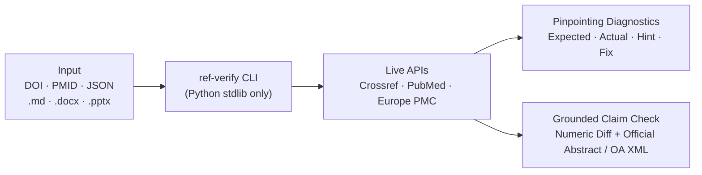

# ref-verify

[](https://github.com/heyiamnotacoder/ref-verify/actions/workflows/ci.yml)


[](LICENSE)

**Python CLI and AI agent skill for verifying scientific citations and grounding quantitative claims against live Crossref, PubMed, and Europe PMC records.**

LLMs routinely hallucinate DOIs, swap PMIDs, miss retractions, misattribute first authors, or subtly alter hazard ratios and sample sizes. Plain pass/fail linters leave an agent guessing what went wrong. `ref-verify` emits structured, **pinpointing diagnostics** (`Expected`, `Actual`, `Hint`, `Fix`, `TokenDiff`, and `DID_YOU_MEAN` recovery suggestions) alongside the paper's official abstract so an AI agent—or a human author—can fix broken citations in a single pass.



---

## Features

- **Identifier validation & live resolution** — Normalizes DOIs and PMIDs (catching trailing punctuation, missing `10.` prefixes, spaces, URL parameters, and PMCID/PMID mix-ups) and cross-resolves them via Crossref, NCBI PubMed E-utilities, and Europe PMC.
- **PMID–DOI conflict detection** — Flags `CRITICAL` errors when a cited DOI and PMID point to different papers.
- **Retraction & editorial notice checks** — Detects retracted papers (`CRITICAL`), expressions of concern (`WARNING`), retraction notices (`WARNING`), and errata/corrections (`INFO`).
- **Field-level metadata diffs** — Checks title (distinguishing subtitle truncation from wrong papers via similarity + token diffs), first author (distinguishing co-author position from absent authors), publication year (distinguishing ±1-year epub-ahead-of-print offsets), and journal name/abbreviation (with biomedical alias normalization).
- **Quantitative claim grounding** — Extracts numbers, percentages, HR/OR/RR, 95% CIs, p-values, sample sizes, and doses from a claim, diffs them against the official abstract (and Open Access JATS full-text XML from NCBI PMC with Europe PMC fallback when `--fulltext` is passed), and prints the matched sentences plus full abstract.
- **Document scanning** — Extracts and verifies every DOI and PMID directly from `.md`, `.txt`, `.docx`, and `.pptx` files (including footnotes, split XML runs, and slide speaker notes). For entries under a References/Bibliography heading (or numbered entries), it also parses the cited title, first author, year, and journal from Vancouver/NLM or APA text so those fields are cross-checked too; ambiguous entries are left unparsed rather than guessed.
- **Checks your own sentences** — `scan` finds every sentence that cites a reference (`[3]`, superscripts, `(Author et al., 2019)`, inline DOIs) and checks that its numbers appear in that paper's abstract. A number cited to several papers at once counts as found if any of them reports it.
- **Human-readable checklist** — `batch` and `scan` end with a one-row-per-citation table of ✓ / ⚠ / ✗ / — marks for every check, followed by a "what to fix" list; `--html report.html` writes the same checklist as a self-contained page with clickable DOIs and expandable details.
- **Zero runtime dependencies** — Pure Python 3.10+ standard library. Runs anywhere without virtualenvs or compiled wheels.

---

## Installation

### CLI

Using [`uv`](https://docs.astral.sh/uv/) (recommended):

```bash
uv tool install git+https://github.com/heyiamnotacoder/ref-verify.git
```

Using `pipx`:

```bash
pipx install git+https://github.com/heyiamnotacoder/ref-verify.git
```

Using `pip`:

```bash
pip install git+https://github.com/heyiamnotacoder/ref-verify.git
```

### AI Agent Skill

Install the portable `ref-verify` skill into Claude Code, Codex, Cursor, or any compatible coding agent:

```bash
npx skills add heyiamnotacoder/ref-verify
```

---

## Usage

### 1. Check a single citation and quantitative claim

```bash
ref-verify check \
  --doi "10.1056/NEJMoa1911303" \
  --pmid "31535829" \
  --author "McMurray" \
  --year 2019 \
  --journal "NEJM" \
  --claim "Dapagliflozin 10 mg in 4,744 patients reduced the primary outcome (16.3% vs 21.2%; HR 0.74, 95% CI 0.65-0.85, p<0.001)."
```

Add `--fulltext` when a claim references subgroup or secondary outcomes that live outside the abstract (fetches Open Access JATS full-text XML from NCBI PMC with Europe PMC fallback whenever a PMCID exists).

### 2. Batch-verify a bibliography (`JSON` file or `stdin`)

Create a JSON array of citation objects (`id`, `doi`, `pmid`, `title`, `author`, `year`, `journal`, `claim`, `fulltext`):

```json
[
  {
    "id": "dapa-hf",
    "doi": "10.1056/NEJMoa1911303",
    "pmid": "31535829",
    "author": "McMurray",
    "year": 2019,
    "journal": "NEJM",
    "claim": "In 4,744 patients, dapagliflozin reduced the primary outcome (HR 0.74, 95% CI 0.65-0.85, p<0.001)."
  },
  {
    "id": "empa-reg",
    "doi": "10.1056/NEJMoa1504720",
    "author": "Zinman",
    "year": 2015,
    "fulltext": true
  }
]
```

```bash
ref-verify batch refs.json
cat refs.json | ref-verify batch - --json
```

### 3. Scan a manuscript, Markdown draft, or slide deck

```bash
ref-verify scan manuscript.docx
ref-verify scan journal_club.pptx --no-abstract
ref-verify scan review.md --json
ref-verify scan thesis.docx --no-abstract --html thesis-references.html
```

### 4. Read the checklist

Human-readable `batch` and `scan` output ends with a checklist: one row per citation, one column per check.

```text
CITATION CHECKLIST  (6 references: 1 pass, 1 warn, 3 fail, 1 unverified)
#  Where    Reference                    DOI/PMID  Retraction  Title  Author  Year  Journal  Claim  Result
----------------------------------------------------------------------------------------------------------
1  line 5   McMurray 2019, 10.1056/N...     ✓          ✓         ✓      ✓      ✓       ✓       —    PASS
2  line 6   Zinman 2015, 10.1056/NEJ...     ✓          ✓         ✓      ✓      ⚠       ✓       —    WARN
3  line 7   Packer 2020, 10.1056/NEJ...     ✓          ✓         ✓      ✓      ✓       ✗       —    FAIL
4  line 8   Wakefield 1998, 10.1016/...     ✓          ✗         ✓      ✓      ✓       ✓       —    FAIL
5  line 9   10.1136/bmj.n99999999           ✗          —         —      —      —       —       —    FAIL
6  line 10  6. Ali F, Vyas J, Finlay...     ⚠          —         —      —      —       —       —    UNVERIFIED
----------------------------------------------------------------------------------------------------------
✓ pass   ⚠ warning   ✗ fail   i note   — not checked (no value to compare, or the paper did not resolve)

WHAT TO FIX:
  [2] line 6 | Zinman 2015, 10.1056/NEJMoa1504720
      ⚠ Year: YEAR_MISMATCH: Cited year 2016 differs by ±1 year from official dates (published_print=2015 / published_online=2015).
        Fix: Update citation year to 2015 to match the official record.
  ...
```

- **—** means the check did not run (no cited year was given, the official record has no journal, or the DOI/PMID did not resolve). A ✓ always means the value was compared and matched.
- A numbered reference wrapped over several lines is read as one entry, and a paper cited in the body and again in the References list is one row, pointing at the reference entry.
- **UNVERIFIED** rows are bibliography entries with no DOI or PMID; add an identifier or verify them with `batch`.
- Ticks fall back to ASCII (`ok ! X -`) when the terminal encoding cannot show them; colour is used only on a TTY and honours `NO_COLOR`.
- `--html <path>` writes the same checklist as a standalone page (no external assets) with summary counts, a "Needs attention" filter, clickable DOI/PubMed links, and per-row details (cited-as text, official record, and every diagnostic with its fix).

### Flags & exit codes

| Flag | Description |
| --- | --- |
| `--fulltext` | Fetch Open Access full-text JATS XML (NCBI PMC `efetch` with Europe PMC fallback) in addition to the abstract. |
| `--no-abstract` | Omit the full `OFFICIAL ABSTRACT` block from text output. |
| `--json` | Emit structured JSON for downstream scripts or agents. |
| `--strict` | Treat `WARNING` diagnostics as failures (exit `1`). |
| `--timeout <sec>` | Per-request HTTP timeout in seconds (default: `15.0`). |
| `--workers <n>` | Max concurrent verification workers for `batch` and `scan` (default: `8`; use `1` for sequential). |
| `--html <path>` | Also write a self-contained HTML checklist report for `batch` and `scan` (works alongside `--json`). |

- **Exit `0`**: Pass (or warning without `--strict`).
- **Exit `1`**: Fail (any `CRITICAL`/`ERROR`, or `WARNING` with `--strict`).
- **Exit `2`**: Invalid arguments, malformed JSON, unreadable input file, or an `--html` path that cannot be written.

---

## Diagnostic Codes

| Severity | Code | What it catches | What `ref-verify` returns to help fix it |
| --- | --- | --- | --- |
| `CRITICAL` | `RETRACTED_PAPER` | Paper flagged retracted in PubMed, Crossref, or Europe PMC | Retraction source, date, and notice DOI |
| `CRITICAL` | `PMID_DOI_CONFLICT` | Cited DOI and PMID resolve to different papers | Both resolved titles/DOIs/PMIDs side by side |
| `ERROR` | `DOI_SYNTAX_INVALID` / `PMID_SYNTAX_INVALID` | Trailing punctuation, URL junk, missing `10.`, or PMCID in PMID slot | Exact syntax issue + `Cleaned` candidate verified live |
| `ERROR` | `DOI_NOT_FOUND` / `PMID_NOT_FOUND` | Unresolvable identifier (404 / hallucinated / typo) | Ranked `DID_YOU_MEAN` matches when `--title` is supplied |
| `ERROR` | `TITLE_MISMATCH` | Cited title diverges from official record | Similarity score + word-level `TokenDiff` |
| `ERROR` / `WARNING` | `AUTHOR_MISMATCH` | First author does not match (`WARNING` if co-author, `ERROR` if absent) | Actual first author, author position, and full author list |
| `ERROR` / `WARNING` | `YEAR_MISMATCH` | Year differs (`WARNING` for ±1-yr epub offset, `ERROR` for ≥2 yrs) | Official `print` and `online` publication years |
| `ERROR` | `JOURNAL_MISMATCH` | Cited journal diverges from official full/abbreviated name | Official full title + PubMed ISO abbreviation |
| `WARNING` / `INFO` | `CLAIM_NUMBER_NOT_IN_ABSTRACT` | Quantitative value in `--claim`, or in a manuscript sentence citing the paper (`scan`), not found in the fetched abstract/OA text of any paper that sentence cites (`INFO` when a co-cited reference could not be read) | Missing tokens, abstract numbers, the quoted sentence and its location, and official abstract |
| `WARNING` | `CLAIM_COHORT_MISMATCH` | Matched number in `--claim` belongs to a subgroup or different cohort in the source text | Claimed cohort vs source subgroup/cohort and exact matched clause |
| `WARNING` | `DUPLICATE_REFERENCE` | `scan` found the same paper (DOI/PMID) as more than one entry in the reference list | Every location of the duplicate and which entry to keep |
| `WARNING` | `UNLINKED_BIBLIOGRAPHY_ENTRIES` | `scan` found bibliography entries under References/Bibliography with no DOI or PMID | Count, locations, previews, and hint to add DOIs/PMIDs or run `batch` |
| `WARNING` / `INFO` | `EXPRESSION_OF_CONCERN` / `RETRACTION_NOTICE` / `HAS_CORRECTION_NOTICE` | Editorial notice or published erratum | Notice metadata so the author checks whether results changed |

---

## Example Output

```bash
ref-verify check \
  --doi "10.1056/NEJMoa1911303." \
  --author "Solomon" \
  --year 2021 \
  --journal "The Lancet" \
  --claim "Dapagliflozin 10 mg reduced the primary outcome by 40% (HR 0.60, 95% CI 0.50-0.70, p<0.001)." \
  --no-abstract
```

```text
==============================================================================
STATUS: FAIL  |  TARGET: 10.1056/NEJMoa1911303.
------------------------------------------------------------------------------
OFFICIAL METADATA (Sources: pubmed, crossref):
  Title   : Dapagliflozin in Patients with Heart Failure and Reduced Ejection Fraction
  Authors : McMurray JJV, Solomon SD, Inzucchi SE, Køber L, Kosiborod MN, Martinez FA, ... (39 authors)
  Year    : print=2019 / online=2019
  Journal : The New England journal of medicine (N Engl J Med)
  IDs     : DOI:10.1056/NEJMoa1911303 | PMID:31535829
------------------------------------------------------------------------------
DIAGNOSTICS (5):
  [!] [ERROR] DOI_SYNTAX_INVALID: Malformed DOI '10.1056/NEJMoa1911303.': trailing punctuation '.'.
      Expected : 10.<4-9 digits>/<suffix>
      Actual   : 10.1056/NEJMoa1911303.
      Cleaned  : 10.1056/NEJMoa1911303
      Hint     : Common copy-paste error: trailing sentence punctuation, missing '10.' prefix, spaces, or URL parameters.
      Fix      : Replace '10.1056/NEJMoa1911303.' with '10.1056/NEJMoa1911303' (verified live: "Dapagliflozin in Patients with Heart Failure and Reduced Ejection Fraction", 2019).
  [!] [ERROR] YEAR_MISMATCH: Cited year 2021 mismatches official publication year by 2 years (published_print=2019 / published_online=2019).
      Expected : cited=2021
      Actual   : published_print=2019 / published_online=2019
      Hint     : A 2-year discrepancy is not an epub-ahead-of-print offset — check for typo or wrong paper.
      Fix      : Confirm the DOI/PMID matches the intended paper, then correct the year to 2019.
  [!] [ERROR] JOURNAL_MISMATCH: Cited journal "The Lancet" does not match official journal (full="The New England journal of medicine" / abbrev="N Engl J Med"); similarity=0.27.
      Expected : cited="The Lancet"
      Actual   : full="The New England journal of medicine" / abbrev="N Engl J Med"
      Hint     : Low journal similarity — either wrong paper/DOI or non-standard journal name.
      Fix      : Replace journal with "N Engl J Med" (official: "The New England journal of medicine").
  [*] [WARNING] AUTHOR_MISMATCH: Cited author "Solomon" is author #2 ("Solomon SD"), NOT first author ("McMurray JJV").
      Expected : cited_author="Solomon"
      Actual   : actual_first_author="McMurray JJV"; full_authors=['McMurray JJV', 'Solomon SD', 'Inzucchi SE', 'Køber L', 'Kosiborod MN', 'Martinez FA', 'Ponikowski P', 'Sabatine MS', 'Anand IS', 'Bělohlávek J', '... (39 total)']
      Hint     : "Solomon" is on the paper as author #2, not the first author.
      Fix      : Replace cited first author with "McMurray JJV" (or cite "McMurray et al.").
  [*] [WARNING] CLAIM_NUMBER_NOT_IN_ABSTRACT: Claim contains quantitative value(s) NOT found in the official abstract: 95% CI 0.50-0.70, HR 0.60.
      Expected : claim_numbers=['p<0.001', '95% CI 0.50-0.70', 'HR 0.60', '40%', '10 mg']
      Actual   : matched=['p<0.001', '40%', '10 mg']; missing=['95% CI 0.50-0.70', 'HR 0.60']; abstract_numbers=['P<0.001', '95% confidence interval [CI], 0.65 to 0.85', '95% CI, 0.59 to 0.83)', '95% CI, 0.69 to 0.98)', '95% CI, 0.71 to 0.97)', 'hazard ratio, 0.74', 'hazard ratio, 0.70', 'hazard ratio, 0.82', 'hazard ratio, 0.83', '40%', '16.3%', '21.2%', '10.0%', '13.7%', '9.6%']
      Hint     : Either the claim misstates/hallucinates the paper's numbers, expresses a derived calculation (e.g. RRR from HR), or cites subgroup/secondary results found only in the full text/tables.
      Fix      : Compare the claim word-for-word against the printed OFFICIAL ABSTRACT below (and run with --fulltext or inspect the PDF if needed), then assign verdict: SUPPORTED / PARTIAL / CONTRADICTED / NEEDS_FULLTEXT.
------------------------------------------------------------------------------
CLAIM_CHECK:
  Claim            : Dapagliflozin 10 mg reduced the primary outcome by 40% (HR 0.60, 95% CI 0.50-0.70, p<0.001).
  Numbers extracted: ['p<0.001', '95% CI 0.50-0.70', 'HR 0.60', '40%', '10 mg']
  Numbers matched  : ['p<0.001', '40%', '10 mg']
  Numbers MISSING  : ['95% CI 0.50-0.70', 'HR 0.60']
  Matched Abstract Sentences:
    > RESULTS: Over a median of 18.2 months, the primary outcome occurred in 386 of 2373 patients (16.3%) in the dapagliflozin group and in 502 of 2371 patients (21.2%) in the placebo group (hazard ratio, 0.74; 95% confidence interval [CI], 0.65 to 0.85; P<0.001).
```

---

## Scope & Limitations

- **Deterministic metadata + grounded evidence**: Identifier resolution, retraction flags, metadata diffs, and numeric extraction are 100% deterministic. Semantic claim verification (direction of effect, subgroup caveats, exact population) is performed by comparing the claim against the printed official abstract or Open Access full text (NCBI PMC / Europe PMC)—never from model memory.
- **Paywalled full text**: When a secondary endpoint or table figure lives only in a paywalled PDF without an Open Access XML copy in NCBI PMC or Europe PMC, `ref-verify` flags the missing numbers so you know to inspect the PDF directly.
- **Live APIs required**: Every check needs Crossref, PubMed, or Europe PMC to answer. During an outage a citation shows `LOOKUP_ERROR` (✗ in DOI/PMID) rather than a false pass.

### Document scanning (`scan`)

- **File types**: `.md`, `.txt`, `.docx`, and `.pptx` only. PDFs, `.doc`, `.odt`, Keynote, and Google Docs/Slides must be exported first.
- **What counts as a reference list**: Plain-text references (no DOI/PMID) are found only under a heading named References, Bibliography, Works Cited, or Literature Cited. Lists under other headings ("Sources", "Literature", "Further reading") and slide footnotes without such a heading produce no row.
- **Identifiers on one line**: A DOI broken across two lines (or split by a hyphen at a line end) is not detected.
- **Duplicate references**: The same DOI/PMID listed twice in one References list becomes one row with a `DUPLICATE_REFERENCE` warning naming every copy. The same paper in two separate lists (e.g. each slide's own References) is not a duplicate. Not detected: duplicates without any DOI/PMID, and a pair where one copy has only the DOI and the other only the PMID.
- **Unlinked entries are not verified**: An `UNVERIFIED` row is listed but never looked up (no title search). Add the DOI/PMID, or check it with `batch` using `title`/`author`/`year`.
- **Wrapped references**: A numbered reference wrapped over several lines is read as one entry. An *unnumbered* reference wrapped over several lines (e.g. an APA list in a `.txt` file) is read line by line and can produce extra `UNVERIFIED` rows.
- **Citing sentences checked for numbers (and stated population) only**: `scan` checks that the numbers in each citing sentence (%, HR/OR/RR, 95% CI, p-values, sample sizes, doses) appear in the cited paper's abstract (or OA full text with `--fulltext`); a percentage that equals a relative reduction derived from a reported ratio (26% from HR 0.74) counts as found. A population the sentence names is compared with the paper's: a contradiction (e.g. HFpEF stated, HFrEF studied) is a warning, while a sentence that only omits a subgroup qualifier gets a note (`i`), because running text often leaves the population implicit. Wording, direction of effect, and interpretation are not judged. A sentence without numbers is listed but its Claim cell shows "—" (this also applies to `--claim` text without numbers).
- **Background numbers**: Counts in background prose ("3 trials", "52 weeks") are checked like results and can raise a warning when the abstract does not mention them; read the warning as "check by hand", not "wrong".
- **Citation styles for citing sentences**: `[3]`, `[1,4-6]`, `(3)` directly before punctuation or the end of a sentence, Word/PowerPoint superscript numbers, typed superscript characters (¹²³), `(Author et al., 2019)`, `Author et al. (2019)`, and inline DOIs/PMIDs. Not recognised: `(3)` followed by more words (it reads as an enumeration), footnote-style citations, and author-year citations whose reference entry could not be parsed for author and year.
- **Numbered citations need a matching list**: `[3]` maps to entry 3 of the References list (or the 3rd entry when Word auto-numbering hides the numbers). When several lists reuse the same number (e.g. every slide restarting at 1) and the citing slide has no list of its own, the citation is skipped.
- **Sentence boundaries**: Sentences are split per paragraph/line; a sentence hard-wrapped across lines in a `.txt`/`.md` file is checked in pieces. Abbreviations other than common ones (et al., e.g., i.e., vs., Fig., Ref., approx., cf.) may split a sentence early.
- **Superscripts that are exponents**: A superscript after a unit (kg/m²), after 10 (10³), or after a one- or two-letter symbol (I², R², χ²) is treated as an exponent, not a citation; a genuine citation written directly after "10" or a two-letter word is missed for the same reason.

### Reading cited title, author, year, and journal

`scan` fills these fields only when the reference entry's shape is unambiguous; otherwise the column shows "—" (not checked) instead of guessing.

- **Supported styles**: Vancouver/NLM (including Lancet-style punctuation) and APA. Harvard-style "Smith J (2019) Title…" yields author and year only.
- **Left unchecked by design**: titles containing a period ("vs.", "E. coli", "St. John's"), dotted journal abbreviations ("N. Engl. J. Med."), group/committee authors and entries with no author list (only journal and year are read; e.g. consensus reports), one- or two-word titles (acronyms like "DAPA-HF"), and bracketed translated titles ("[Effect of …]").
- **Where parsing applies**: only to lines under a References heading or lines starting with a number ("1.", "[1]"). A DOI in running text is checked by identifier only; if the same paper also appears in References, the row uses that entry.
- **Residual risk**: An unusual entry that still matches the expected shape can be mis-split and show a false Title/Journal mismatch. The "Cited as" line under each problem shows the exact text that was read, so a mis-read is easy to spot.

### Checklist table and HTML report

- **Terminal width**: On narrow terminals the Where and Reference columns are truncated; the HTML report and the "What to fix" list show them in full.
- **Symbols**: Terminals that cannot print ✓ ⚠ ✗ — fall back to `ok ! X -`. A few terminals render ⚠ as a wide emoji, which shifts that row's alignment by one column.
- **Exit codes**: `UNVERIFIED` rows (no DOI/PMID) are warnings: they make `scan` exit `1` only with `--strict`.
- **HTML report**: A static snapshot; re-run `ref-verify` to refresh it. Expanding rows needs JavaScript (printing shows every row's details). It contains your reference text, so share it as you would the manuscript.

---

## Optional Environment Variables

- **`NCBI_API_KEY`**: PubMed E-utilities permits 3 requests/second without an API key and 10 requests/second with one. `ref-verify` paces requests automatically and uses `NCBI_API_KEY` when set.
- **`REF_VERIFY_MAILTO`**: Optional contact email included in the Crossref `User-Agent` header for Polite Pool routing.

```bash
export NCBI_API_KEY="your-ncbi-api-key"
export REF_VERIFY_MAILTO="you@example.org"
```

---

## Development

Run the local lint, format, and offline unit test gate:

```bash
./scripts/check.sh
```

---

## License

MIT — see [LICENSE](LICENSE).
